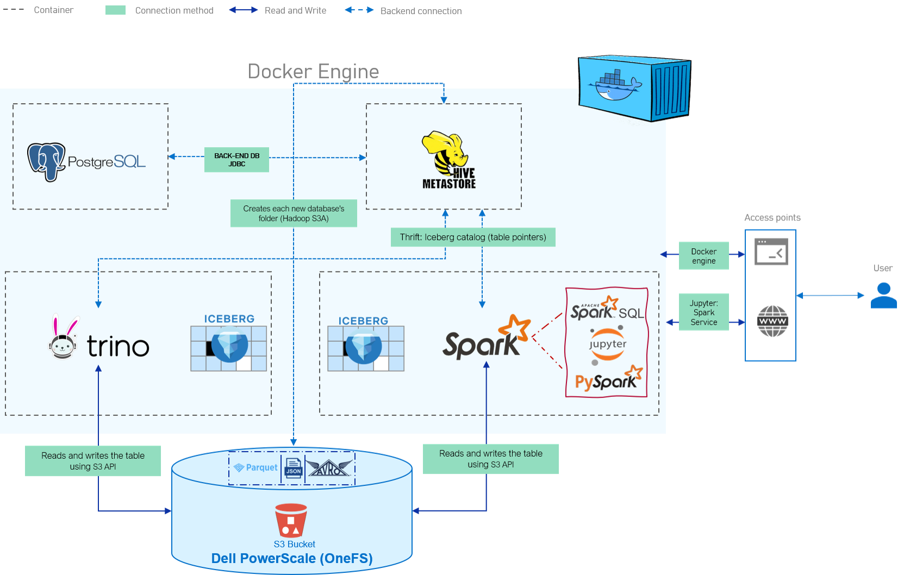

# High Level Architecture of the Demo Instances 




## Demo objective

Show open source lakehouse tools working with Dell PowerScale as their storage, using its S3 interface.

By the end of the demo you will see:
* Spark and Trino reading and writing the **same Iceberg table** on PowerScale
* How Iceberg organises a table into **three layers**: catalog, metadata and data
* Where each layer lives: the catalog in the Hive Metastore (PostgreSQL),
  the metadata and data files on PowerScale
* Iceberg features driven by its metadata, such as **snapshots and time travel**


## Demo scope

A small, self-contained setup to test an open source lakehouse stack, sized to run with Docker Compose.

**Software (Docker images)**
* **Apache Spark + Iceberg + Jupyter**
based on `tabulario/spark-iceberg`, customised for PowerScale (Iceberg 1.10, Hadoop S3A connector, Trino client)
* **Trino**
second query engine on the same tables
* **Apache Hive Metastore 4.0**
one shared Iceberg catalog for Spark and Trino
* **PostgreSQL 14**
backend database for the Hive Metastore

**Compute**
* Any Docker-compatible host: a virtual machine or bare metal
* x86 (64-bit) required by the Spark image

**Storage**
* Dell PowerScale (OneFS) S3, on premises
* One bucket, `warehouse`, holding all table data and Iceberg metadata

**Network**
* Containers talk to each other on a private Docker network
* PowerScale is reached over the internal network on its S3 port (9020)

**Lab simplifications (not for production)**
* S3 over HTTP rather than HTTPS
* Root S3 keys and default database passwords

## Prequisites 

### Create S3 buckets on PowerScale (OneFS)

Run these commands on the PowerScale cluster. Connect from any terminal with SSH,
using the root password you use for the OneFS web UI:

    ssh root@<PowerScale IP>

**1. Enable the S3 service**

Check whether it is running:

    isi services s3

If it shows as disabled, turn it on:

    isi services s3 enable

**2. Allow HTTP on port 9020**

This lab uses S3 over HTTP, because the containers cannot easily trust PowerScale's
self-signed HTTPS certificate:

    isi s3 settings global modify --https-only=false

**3. Create the bucket with its own folder**

    isi s3 buckets create warehouse /ifs/home/warehouse --create-path --owner root

* `warehouse` is the **bucket name**: what Spark and Trino use, e.g. `s3a://warehouse/...`
* `/ifs/home/warehouse` is the **path**: the folder on PowerScale where the files are stored
* `--create-path` creates that folder. Without it, the bucket points to a folder that does
  not exist and every write fails with "The specified key does not exist" (404)
* `--owner root` makes root the owner, so root's S3 key can read and write the bucket

> In the web UI (**Protocols > Object storage (S3) > Buckets**), enter the folder in the
> **Path** field and tick **Create path**. The **Description** field is only a label.

**4. Generate an S3 access key** for the bucket owner

    isi s3 keys create root

Copy both values straight away. The secret is shown only once:
* **Access ID**, for example `1_root_accid`
* **Secret key**

> In the web UI: **Protocols > Object storage (S3) > Key management > Add**, then pick the user.

**5. Check the setup**

On the cluster:

    isi s3 buckets list
    ls -ld /ifs/home/warehouse

The bucket should show the path `/ifs/home/warehouse`, and the folder should exist.
Type `exit` to leave the cluster, then from the Docker host:

    curl http://<PowerScale IP>:9020

An XML reply means S3 is reachable over HTTP.

**6. Update the `.env` file**

In the demo folder, open `.env` and fill in the PowerScale IP and the key from step 4:

    POWERSCALE_HOST=<PowerScale IP>
    POWERSCALE_PORT=9020
    POWERSCALE_BUCKET=warehouse
    POWERSCALE_ACCESS_KEY=1_root_accid
    POWERSCALE_SECRET_KEY=<your secret key>

No quotes and no spaces around `=`. Also put the same IP in `conf/spark-defaults.conf`
(the `s3.endpoint` and `fs.s3a.endpoint` lines), since that file cannot read `.env`.

### Install and setup docker environment 
* A VM or bare-metal server, **x86 (64-bit)**
* **Docker Engine** and the **Docker Compose plugin** (`docker compose version` should work)
* **Internet access** to pull the images and download the jars
* **Network access to PowerScale** on port 9020. To check, run this from the host:
  `curl http://<PowerScale IP>:9020` (an XML reply means S3 is reachable)

### Make sure ports used by the environment are free

| Port | Service | Used for | 
|---|---|---|
| 8888 | Spark container | Jupyter notebook | 
| 4040 | Spark container | Spark UI (jobs and queries) | 
| 8080 | Trino | Trino web UI and client connections |
| 9083 | Hive Metastore | Thrift catalog connection | 
| 5432 | PostgreSQL | Metastore database | 
| 9020 | PowerScale S3 (HTTP) |

### Start The Environment 

Download the files attached to this GitHub and go to your command prompt make sure you are in the file downloaded 'hive-iceberg-demo' and run below command. 
```
 docker compose build spark
 docker compose up -d 

```
Open Jupyter at `http://<Docker host IP>:8888 and run the examples by order. 


